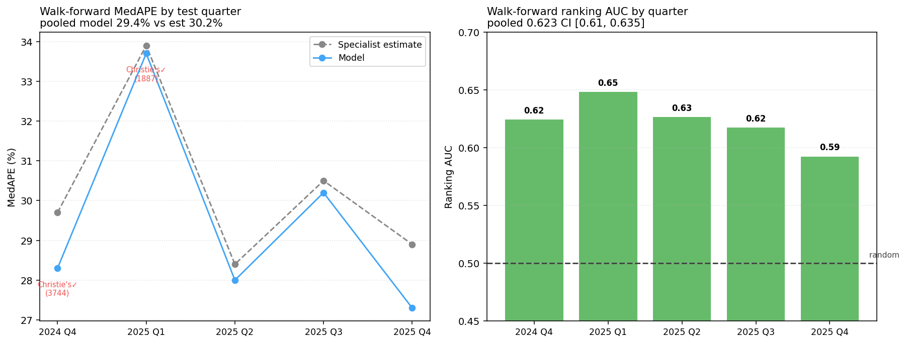
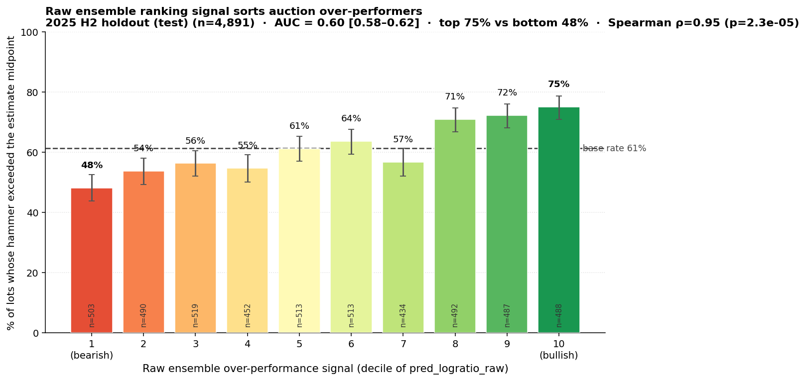

# 🎨 Art Auction Price Predictor

> Predict hammer prices for fine art auctions with an interpretable ensemble model — and, more importantly, a *calibrated uncertainty interval* around every prediction. Built for researchers, collectors, and art advisors.


-blueviolet)
-0.897-brightgreen)


---

## Overview

**Art Auction Price Predictor** estimates the hammer price of artworks at Christie's, Bonhams, Phillips, and Sotheby's. It combines a stacked ensemble of two gradient-boosting models (LightGBM + CatBoost) with **conformal prediction intervals** and a **SHAP explainability layer** — giving you not just a number, but a calibrated range and *why* the model landed there.

> 📄 **For the full methodology and findings, see the [Technical Report](TECHNICAL_REPORT.md). For how the dataset was built and audited, see the [Data Card](DATA.md).**

**The honest headline:** the auction specialist's own low–high estimate is a *near-efficient* point predictor. On a strictly clean test set (2025 H2 — held out of training **and** of the validation set used to fit calibration/shrink), the model **matches** the estimate on point accuracy (MedAPE 29.2% vs 29.2%; it wins on raw-$ R², 0.890 vs 0.882, and is fractionally behind on within-20%). That is the correct, Mei-Moses-consistent result: a near-efficient benchmark is not meaningfully beatable on point accuracy, and a model that *claimed* to would be over-fitting. Where the model adds real, measurable value is **ranking** — sorting which lots will beat vs. miss their estimate (test AUC **0.60**, 95% CI [0.58, 0.62], excludes 0.5; broadly monotonic decile lift 48%→75%, clear top-vs-bottom) — and **calibrated uncertainty** (an 80% interval with **82.2%** empirical coverage) plus SHAP attribution, neither of which the estimate provides. An **estimate-anchored shrink** (Stage C) keeps the point prediction from straying past the estimate where it lacks validated signal. This project is built to be defensible, not to flatter a leaderboard. See [Honest Evaluation](#honest-evaluation).

**Who it's for:**
- 🔬 **Researchers** — a reproducible, leakage-free, fine-art-only dataset of 129k priced lots (151k total incl. unsold, 2018–2026) with point-in-time features
- 🖼️ **Collectors** — a calibrated price *range* to sanity-check a specialist estimate before bidding
- 💼 **Art advisors** — scenario-test provenance, medium, and timing, with SHAP attribution

---

## Results

The right question is not "what's the R²" (the estimate alone gets you most of the way) but **"does the model add anything beyond the auctioneer's estimate?"** The primary evaluation is a **purged walk-forward cross-validation** — the standard rigorous protocol for time-series models — not a single split.

### Primary: walk-forward CV (5 rolling quarters, 18,643 out-of-sample lots)

Each fold trains on the past, refits the *entire* calibration chain (isotonic → group-bias → Stage-C shrink → CQR) on its own validation quarter, and tests on the next quarter (1-month embargo at the seam). Predictions are pooled across folds. Crucially, this brings **Christie's** — 57.2% of training but absent from any single recent split (their data caps 2025-03-27) — back into the test set with **5,631 clean out-of-sample lots**.

| Metric | Estimate-only | **Ensemble (+ Stage-C)** | Verdict |
|---|---|---|---|
| MedAPE (all lots) | 30.2% | **29.4%** | **model wins** |
| Within-20% (all lots) | 36.9% | **37.0%** | ≈ tie (model a hair ahead) |
| Raw-$ R² (log space) | 0.887 | **0.897** | model wins |
| **Ranking AUC** (beats vs. misses midpoint) | 0.50 | **0.62** [0.61–0.63] | **real signal** |
| 80% interval empirical coverage | n/a | **80.4%** | ✅ calibrated |

The MedAPE edge is small but **statistically supported**: an artist-clustered paired bootstrap of Δ = MedAPE(model) − MedAPE(estimate) gives **−0.85pp, 95% CI [−1.12, −0.24]** (excludes zero; model better in 100% of resamples). **Stability is the point:** ranking AUC by quarter is **0.63 · 0.65 · 0.63 · 0.62 · 0.59** — steady in *every* fold; the pooled decile staircase runs **50% → 83%** with a perfectly monotonic Spearman ρ = 1.0. On MedAPE the model wins **all 5 quarters** (the closest is 2024 Q4, 28.3 vs 29.7). Per-house, pooled, the model **wins all three**: Christie's **32.8 / 33.9**, Bonhams **27.8 / 28.9**, Phillips **27.9 / 29.2** — AUC ≈0.61 each. The ranking AUC's 95% CI excludes 0.5 under **both** an artist-clustered bootstrap **[0.61, 0.64]** and a sale-clustered (auction-level, 395 sales) bootstrap **[0.61, 0.64]** — robust to either correlation unit. (Reproduce via `ml/walk_forward_eval.py`.)



> **What walk-forward measures:** how the *modeling approach* generalizes across time (each fold is a separate fit). The single deployed artifact in `models/` is one fit; its own strictly-clean holdout is the 2025 H2 quarter below.

### Secondary: most-recent half-year holdout (2025 H2, n = 4,891)

The single most recent forward window, held out of training **and** of the 2025 H1 validation set that fits calibration/shrink/CQR. It happens to be a harder, Christie's-free window, so it reads as a tie rather than a win — a useful conservative lower bound:

| Metric | Estimate-only | **Ensemble** | |
|---|---|---|---|
| MedAPE | 29.2% | 29.2% | tie |
| Within-20% | **37.4%** | 36.8% | est. a hair ahead |
| Raw-$ R² | 0.882 | **0.890** | model wins |
| Ranking AUC | 0.50 | **0.60** [0.58–0.62] | real signal |
| Coverage | n/a | **82.2%** | calibrated |

**How to read all this.** Against a *near-efficient* benchmark, beating point accuracy by a lot is neither expected nor a good sign — an *unconstrained* ensemble actually does **worse** on MedAPE (31.6%), because its extra deviation is noise on the typical lot. The **Stage-C estimate-anchored shrink** (`λ=0` always in-grid ⇒ provably no worse than the estimate on validation) keeps the model at-or-above the estimate. The genuine, robust contribution is **(1) ranking** — a stable AUC ≈0.62 that sorts over- vs. under-performers across every quarter and every house — and **(2) calibrated uncertainty** the estimate cannot give.



<a name="honest-evaluation"></a>
### Honest evaluation & known limitations

- **The estimate is a strong, near-efficient baseline.** Specialists price in most public information; the residual (does a lot beat or miss its estimate?) is genuinely hard to predict. The Stage-C shrink reflects this honestly — a tier only deviates from the estimate when there's real validation evidence (an **evidence gate**), and the surviving weight is confidence-weighted by sample size. So λ is largest in the data-rich lower tiers (where specialist estimates are noisiest and the model adds most) and `λ = 0` for sparse high-value tiers and any tier whose edge is too weak to trust. The model never over-rides the expert on exactly the lots where the expert is strongest.
- **Christie's coverage (resolved by walk-forward).** The Christie's data caps at 2025-03-27, so *any single recent split* (like the 2025 H2 secondary holdout) contains no Christie's. The walk-forward CV fixes this directly: its earlier folds (2024 Q4, 2025 Q1) test on **5,631 clean out-of-sample Christie's lots**, where the model now **wins** (32.8 vs 33.9) and ranks well (AUC 0.61). The remaining gap is *recent* Christie's — collecting Christie's post-March-2025 results would let it into the most-recent folds too.
- **Sotheby's is thin (≈0.8% of data).** It is included for completeness but the model has little Sotheby's-specific signal; do not rely on it there.
- **Point predictions are not investment advice.** See the disclaimer at the bottom.

---

## Architecture

The deployed ensemble is **two models** (LightGBM + CatBoost) combined by NNLS stacking. A neural net and XGBoost were evaluated during development but dropped after a validation ablation showed they added nothing — keeping the predictor lean and PyTorch-free.

```
Input Features (43)
       │
       ├─── LightGBM ──┐               Stage A      Stage B        Stage C
       │               ├─→ NNLS Stack ─→ Isotonic ─→ group-bias ─→ est-anchored ─→ Hammer
       └─── CatBoost ──┘                (tiered)    (medium/house)  shrink (λ)        │
                                                                            ├── P10 (CQR)
                                                                            └── P90 (CQR)
```

**NNLS stacking** learns non-negative least-squares weights on out-of-fold predictions — the deployed weights are **LightGBM 0.66, CatBoost 0.34**. A neural net and XGBoost were trained and evaluated, but a validation ablation showed the neural net changed every metric by <0.06pp and XGBoost got zero NNLS weight, so both were dropped — which also removes the PyTorch dependency entirely. The calibration chain then runs in three stages, all fit on validation only:

- **Stage A — tiered isotonic calibration:** corrects price-tier-dependent bias in log space.
- **Stage B — group-bias correction:** small additive medium- and house-level offsets.
- **Stage C — estimate-anchored shrink:** blends the prediction toward the estimate (`log_ratio = 0`) by a per-tier factor `λ ∈ [0,1]`, grid-searched on validation to minimise MedAPE. A tier only deviates (`λ>0`) if it beats the estimate on that validation tier by a margin (an **evidence gate**), and the surviving λ is **confidence-weighted by sample size** (`w = n/(n+k)`) so sparse tiers shrink toward 0. Since `λ = 0` is in the search space, the model is **provably no worse than the estimate baseline on validation**. The evidence gate is a regularizer *designed* to carry that parity out-of-sample — not a guarantee; empirically, on the 2025 H2 test set and across the walk-forward folds, the model stays at-or-near the estimate on every price tier rather than drifting.

Intervals come from **Conformalized Quantile Regression (CQR)** on the q10/q90 LightGBM models, fit on validation against the *post-Stage-C* prediction so empirical 80% coverage holds (measured **82.2%** on the 2025 H2 test set).

---

## Dataset

| Stat | Value |
|---|---|
| Total cleaned lots | 150,808 (fine art only; wine/spirits excluded) |
| Lots with hammer price | 129,023 (86%) |
| Christie's share | 57.2% |
| Bonhams share | 29.5% |
| Phillips share | 12.5% |
| Sotheby's share | 0.8% |
| Date range | 2018–2026 |
| Sell-through rate | ~86% |
| Unique artists | ~44,000 |
| Price range (hammer) | $12 – $324M (median ≈ $17k) |

**Evaluation is temporal, never shuffled.** The primary protocol is **purged walk-forward CV** (5 rolling quarters, full calibration chain refit per fold, 1-month embargo — see [Results](#results)). The single deployed artifact uses **train ≤ 2024 · validation = 2025 H1 · test = 2025 H2**, with calibration / Stage-C / CQR fit on validation only and its holdout numbers computed on the untouched 2025 H2 quarter. Walk-forward's earlier folds restore Christie's (capped 2025-03-27) to the out-of-sample test set.

---

## Feature Groups

*Generated from `meta["feature_cols"]` (42 engineered features) so it can't drift. At train time `sell_through_prob` is appended as feature #43, the model's actual input width.*

| Group | Count | Features |
|---|---|---|
| Estimate | 4 | `log_estimate_mid`, `estimate_range_pct`, `log_estimate_spread`, `estimate_tightness` |
| Artist history | 13 | `artist_n_past_sales`, `artist_median_log_hammer`, `artist_median_ratio`, `artist_sell_through_rate`, `artist_log_price_std`, `artist_last_ratio`, `artist_smoothed_ratio`, `artist_house_ratio`, `artist_prestige_score`, `artist_nationality_region`, `days_since_last_sale`, `artist_sell_thru_12m`, `lot_vs_artist_median` |
| Artist momentum | 3 | `artist_momentum_6m`, `artist_momentum_12m`, `artist_momentum_accel` (cumulative-median change proxies) |
| Artwork | 4 | `medium_cat`, `log_width`, `log_height`, `aspect_ratio` |
| Provenance & title | 4 | `provenance_len`, `prov_auction_count`, `prov_private_collection`, `log_title_length` |
| Temporal | 4 | `sale_year`, `artwork_age`, `sale_month_sin`, `sale_month_cos` |
| Sale context | 5 | `house_cat`, `is_evening_sale`, `is_online_sale`, `log_lot_number`, `lot_position_pct` |
| Market / macro | 5 | `market_index_3m`, `market_index_12m`, `sp500_ret_3m`, `sp500_ret_12m`, `sp500_level` |

---

## Key Design Decisions

1. **Point-in-time artist features via `merge_asof`** — All artist statistics (median hammer, sell-through rate, momentum) are joined to each lot using `merge_asof(direction="backward", allow_exact_matches=False)` on `sale_date`. Zero temporal leakage even when two lots from the same artist appear in the same auction.

2. **Conformal prediction intervals (CQR)** — P10/P90 come from LightGBM quantile models (`alpha=0.10/0.90`), then conformalized on validation (Romano et al., 2019). Empirical 80% coverage on the held-out 2025 H2 test set (**82.2%** measured), unlike naive ±1σ heuristics.

3. **Multi-house dataset** — A 129k-lot (priced), fine-art-only dataset spanning four major auction houses (Christie's, Bonhams, Phillips, Sotheby's) with consistent field normalization across 2018–2026.

4. **Market-regime features** — Rolling 3- and 12-month internal market index (monthly median log-hammer, merged strictly before each lot), plus external S&P 500 signals. Captures the 2021 boom and 2022 correction.

5. **Confidence-adaptive estimate-anchored shrink (Stage C)** — Rather than letting the model deviate from a near-efficient baseline wherever it likes, a per-tier blend factor `λ` is learned on validation to minimise MedAPE, then shrunk toward 0 by an empirical-Bayes weight `w = n/(n+k)` so tiers with little validation data defer to the estimate. The result: the model leans on itself in the data-rich middle and **defers to the specialist on sparse, high-value lots where the expert is most accurate**. The `λ=0`-in-grid guarantee means it can never do worse than the estimate on validation, and on the 2025 H2 test set it holds parity (MedAPE tie) rather than drifting.

6. **Leakage discipline end-to-end** — Temporal split, OOF sell-through feature, calibration/conformal fit on validation only, and a separate **deploy** path whose in-sample tail metrics are explicitly suppressed (never published). The honest forward metrics above come from the **eval** run.

---

## Quickstart

```bash
# Clone and install
git clone https://github.com/w-jessica-wang/art_price_predictor.git
cd art_price_predictor
pip install -r requirements.txt

# Run the tests (synthetic leakage/calibration/data-quality + docs-sync — no data needed)
pytest tests/ -q

# With the (non-released) dataset + trained artifacts in place:
python -m ml.train              # retrain (writes models/ + eval_manifest.json)
python -m ml.walk_forward_eval  # primary evaluation (5-fold walk-forward)
streamlit run app.py            # launch the app → http://localhost:8501
```

> **Note:** the dataset and trained model binaries are not distributed (see the [Data Card](DATA.md)),
> so a fresh clone can run the test suite and inspect all artifacts' metadata/hashes,
> but not retrain or serve predictions without the data.

### Tests — the key leakage controls are exercised, not just asserted (20 tests, 5 files; run in CI)

- **`test_leakage.py`** — builds synthetic timelines with known answers: `artist_n_past_sales` counts only sales strictly before a lot's own date (0 → 1 → 2), same-date lots never see each other (`merge_asof(allow_exact_matches=False)`), feature values use prior sales only, the **market index never reflects its own month** (a sharp regime shift in one month must not leak into that month's lots), and the temporal `train < val < test` split has no date overlap.
- **`test_calibration.py`** — the Stage-C shrink machinery: λ ∈ [0,1], shrinking never *amplifies* a deviation, and when deviating from the estimate would strictly hurt, every λ collapses to 0 (the "provably no worse than the estimate" guarantee).
- **`test_data_quality.py`** — the fine-art-only invariant: wine/spirits/collectible lots are flagged and dropped (cleaner + `load_data` guard), while real painters (e.g. Henri Fantin-Latour) are spared.
- **`test_docs_sync.py`** — **the anti-drift guard:** asserts the headline numbers in README, model card, and data card match `meta.json` and `walk_forward.json`, and that known-stale tokens never reappear. Fails CI the moment a quoted metric drifts from the trained artifact.
- **`test_inference.py`** — the prediction contract (expected keys, hammer > 0 and finite, P10 ≤ P90) plus a **train/inference-parity** check that the deployed predictor consumes the persisted latest momentum + market index rather than hardcoded constants. Auto-skips when no trained model is present.

The synthetic tests (leakage, calibration, data-quality) need no model and run anywhere; docs-sync runs against the committed `meta.json` + `walk_forward.json`. All of these run on every push/PR via **GitHub Actions** (`.github/workflows/ci.yml`). They exercise the **core leakage controls** and the no-drift guarantee — not the entire end-to-end pipeline (OOF-stacking chronology, calibration-on-validation-only, and saved-vs-regenerated equality are verified by inspection).

---

## Project Structure

```
art_price_predictor/
├── TECHNICAL_REPORT.md       # Methodology, findings, references
├── DATA.md                   # Data card: schema, composition, cleaning audit, provenance
├── app.py                    # Streamlit UI (Predict / Trends / Batch Scoring tabs, SHAP)
├── clean_data.py             # Data cleaning + wine/spirits exclusion → art_auction_clean.csv
├── generate_presale.py       # Batch scoring of no-hammer lots → no_hammer_batch_scores.csv
├── requirements.txt
├── .github/workflows/ci.yml  # CI: runs the test suite (incl. docs-sync) on push/PR
├── models/                   # Deployed artifacts + meta.json + eval_manifest.json (provenance)
├── models_eval/              # Honest forward-eval artifacts + eval_predictions.parquet (split-tagged)
├── figures/
│   ├── decile_lift.py        # Decile-lift / ranking-AUC chart (2025 H2 holdout)
│   └── walk_forward.png      # Walk-forward CV: MedAPE + AUC by quarter
├── tests/
│   ├── test_leakage.py       # Proves point-in-time + market features can't leak
│   ├── test_calibration.py   # Stage-C shrink guarantees
│   ├── test_data_quality.py  # Fine-art-only: wine/spirits excluded, painters spared
│   ├── test_docs_sync.py     # Anti-drift: doc numbers == meta.json / walk_forward.json
│   └── test_inference.py     # Inference contract + train/inference parity
└── ml/
    ├── train.py              # End-to-end training pipeline
    ├── walk_forward_eval.py  # Purged walk-forward CV (primary evaluation)
    ├── predict.py            # ArtPricePredictor inference class
    └── features.py           # Feature engineering (O(n log n) vectorized)

# data/ and the data-collection code are not included in this repository.
```

---

## Results by Price Segment

**2025 H2 test set (n = 4,891), ensemble predictions.** Accuracy improves with lot value — high-value lots have richer artist history and tighter specialist estimates. (Ranking AUC by tier shown to confirm the skill isn't confined to one band.)

| Segment | Lots | MedAPE | Within 20% | Ranking AUC | Notes |
|---|---|---|---|---|---|
| < $10k | 2,918 | 32.5% | 32.6% | 0.63 | Noisiest tier; specialist estimates least reliable |
| $10k – $100k | 1,590 | 25.8% | 39.7% | 0.59 | Core working range |
| $100k – $1M | 341 | 17.8% | 53.7% | 0.61 | Estimate signal very strong |
| > $1M | 45 | 17.4% | 60.0% | — (thin) | Model defers to the specialist (λ=0) — they're most accurate here |

---

## Citation

If you reference this work, please cite:

```bibtex
@software{art_auction_predictor_2026,
  author       = {Wang, Jessica},
  title        = {Art Auction Price Predictor},
  year         = {2026},
  institution  = {University of Michigan},
  url          = {https://github.com/w-jessica-wang/art_price_predictor},
  note         = {Two-model NNLS ensemble (LightGBM + CatBoost) with tiered
                  isotonic calibration and CQR conformal intervals, trained on
                  ~129k priced lots (2018--2026), fine art only. Training data not publicly released.}
}
```

---

## License

**© 2026 Jessica Wang. All Rights Reserved. Proprietary and confidential.**

This repository is provided for **personal evaluation and learning only**. Copying, redistribution, modification, derivative works, commercial use, and training machine-learning models on this code or methodology are prohibited without express written permission. See [LICENSE](LICENSE) for the full terms.

> **Disclaimer:** This tool is for research and informational purposes only. It is not financial advice. Auction markets are inherently volatile and past performance does not predict future results. Always consult a specialist before making purchasing decisions.
>
> This project is an independent research effort. It is **not affiliated with, sponsored by, or endorsed by** Christie's, Bonhams, Phillips, Sotheby's, or any auction house. All house names are used solely to identify the public sources of the underlying auction results.
